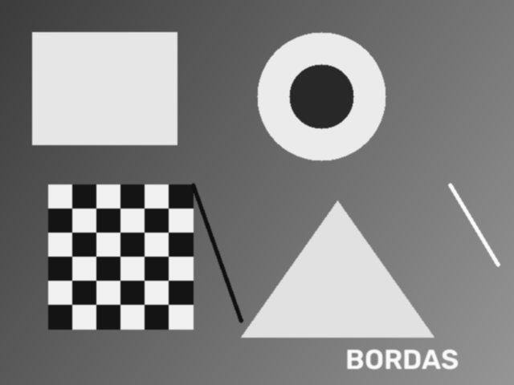
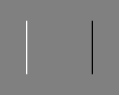
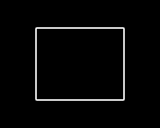
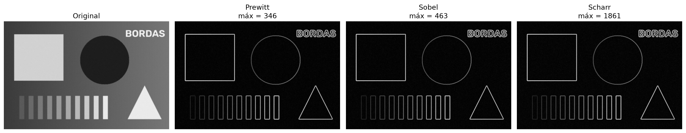
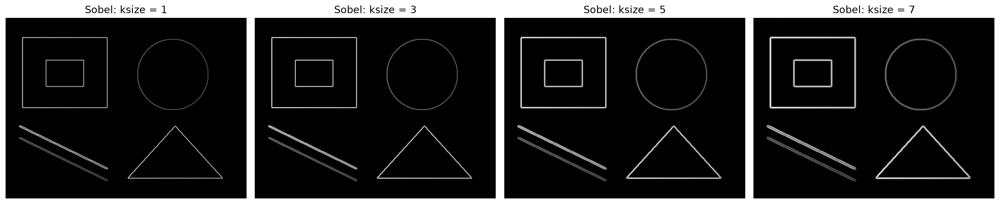
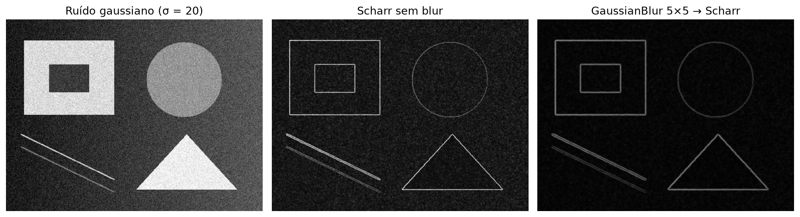
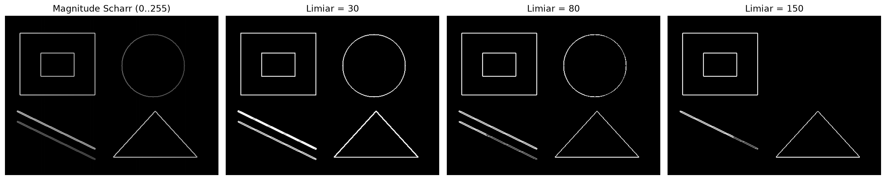
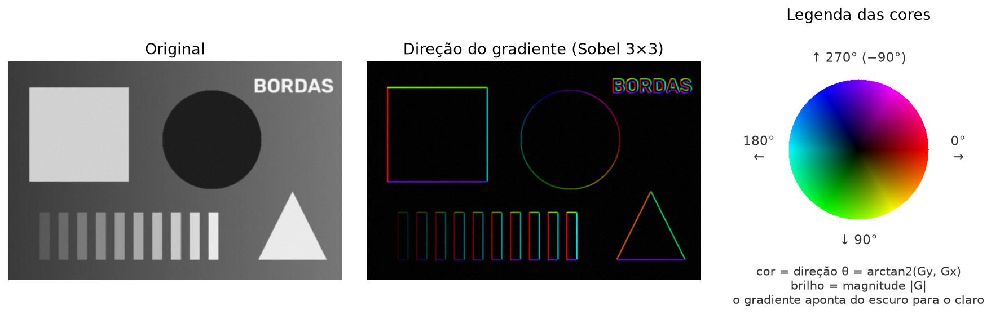

# Detectores de Bordas por Gradiente: Sobel, Prewitt e Scharr

**Grupo 05 | Tema 03 | Processamento de Imagens**

[](https://colab.research.google.com/github/victoandrad/Atividade-Final-CG/blob/main/notebooks/deteccao_bordas.ipynb)

Uma **borda** é um lugar da imagem onde a intensidade (o brilho) muda bruscamente.
O **gradiente** mede essa mudança: em cada pixel ele diz *quanto* a intensidade
varia (magnitude) e *para onde* ela cresce (direção). Os operadores Prewitt, Sobel
e Scharr estimam o gradiente com kernels 3×3 aplicados por convolução.

Este repositório tem o código em Python (OpenCV + NumPy), um notebook para a
demonstração ao vivo, uma interface em Streamlit e as figuras da apresentação.

---

## Fundamentação em uma página

Cada operador usa dois kernels: **Gx** (derivada na horizontal) e **Gy** (derivada
na vertical). Gy é a transposta de Gx.

| Operador | Gx | Gy |
|---|---|---|
| Prewitt | `[[-1, 0, 1], [-1, 0, 1], [-1, 0, 1]]` | `[[-1, -1, -1], [0, 0, 0], [1, 1, 1]]` |
| Sobel   | `[[-1, 0, 1], [-2, 0, 2], [-1, 0, 1]]` | `[[-1, -2, -1], [0, 0, 0], [1, 2, 1]]` |
| Scharr  | `[[-3, 0, 3], [-10, 0, 10], [-3, 0, 3]]` | `[[-3, -10, -3], [0, 0, 0], [3, 10, 3]]` |

- **Magnitude:** `G = sqrt(Gx² + Gy²)`, ou seja, a força da borda
- **Direção:** `θ = arctan2(Gy, Gx)`: aponta do lado escuro para o lado claro e é perpendicular à borda
- **Sobel é separável:** `[1, 2, 1]ᵀ` (suaviza) × `[-1, 0, 1]` (deriva), por isso resiste melhor ao ruído que o Prewitt
- **Scharr** usa pesos `3-10-3` para responder quase igual em todas as direções (melhor isotropia que o Sobel 3×3)
- Os gradientes são calculados sempre em **float64** (`cv2.CV_64F`): em `uint8` os valores negativos seriam cortados para 0 e metade das bordas sumiria

---

## Integrantes

| Integrante | Papel na apresentação | Módulo no código |
|---|---|---|
| **Felipe Caldeira Akryghti** (líder) | Introdução, conclusão, montagem final e entrega | `src/utils.py`, `testes/test_utils.py`, README |
| **Fernando Barros Greca** | Fundamentação teórica (gradiente, convolução, Prewitt, Sobel) | `src/operadores.py`, `testes/test_operadores.py` |
| **Igor Domingues Pereira** | Scharr e análise de parâmetros | `src/scharr_parametros.py`, `testes/test_scharr_parametros.py` |
| **Victor de Andrade Miranda** | Demonstração ao vivo e integração | `src/__init__.py`, `gerar_figuras.py`, notebook, app Streamlit |

---

## Estrutura do repositório

```
├── README.md
├── requirements.txt
├── gerar_figuras.py              # gera todas as figuras de imagens/saida/
├── src/
│   ├── __init__.py
│   ├── utils.py                  # carregar, normalizar, salvar, grade, mapa de direção
│   ├── operadores.py             # kernels, convolução manual, Prewitt, Sobel, magnitude, direção
│   └── scharr_parametros.py      # Scharr, ruído, limiar e figuras de parâmetros
├── testes/
│   ├── test_utils.py
│   ├── test_operadores.py
│   └── test_scharr_parametros.py
├── notebooks/
│   └── deteccao_bordas.ipynb     # demonstração ao vivo
├── app/
│   └── streamlit_app.py          # interface interativa
└── imagens/
    ├── entrada/teste.png
    └── saida/                    # figuras 01 a 09
```

---

## Como rodar

Requisitos: **Python 3.10 ou mais novo**.

### 1. Google Colab (mais fácil, nada para instalar)

Clique no botão **Abrir no Colab** no topo desta página. Se preferir montar à mão,
crie um notebook novo no Colab e rode na primeira célula:

```python
!git clone https://github.com/victoandrad/Atividade-Final-CG.git
%cd Atividade-Final-CG
!pip install -q -r requirements.txt
```

Depois disso os imports funcionam normalmente:

```python
from src.utils import carregar_cinza, mostrar_grade
from src.operadores import aplicar_sobel, magnitude

img = carregar_cinza("imagens/entrada/teste.png")
gx, gy = aplicar_sobel(img)
mostrar_grade([img, gx, gy, magnitude(gx, gy)],
              ["Original", "Gx", "Gy", "Magnitude"], colunas=4)
```

### 2. Jupyter no computador

```bash
git clone https://github.com/victoandrad/Atividade-Final-CG.git
cd Atividade-Final-CG
pip install -r requirements.txt
jupyter notebook notebooks/deteccao_bordas.ipynb
```

### 3. Streamlit (interface interativa)

Na raiz do repositório:

```bash
streamlit run app/streamlit_app.py
```

O navegador abre em `http://localhost:8501`.

### 4. Gerar as figuras e rodar os testes

Na raiz do repositório:

```bash
python gerar_figuras.py      # recria imagens/saida/01 a 09
python -m pytest -v          # roda todos os testes
```

Use `python -m pytest` (e não só `pytest`): o `-m` coloca a raiz do repositório
no caminho do Python, e é isso que faz o `from src.utils import ...` funcionar.

---

## Galeria das figuras

Todas são geradas por `gerar_figuras.py` a partir de `imagens/entrada/teste.png`.

| | | |
|:---:|:---:|:---:|
|  |  |  |
| **01** Imagem original em tons de cinza | **02** Sobel Gx: bordas verticais | **03** Sobel Gy: bordas horizontais |
|  |  |  |
| **04** Magnitude do Sobel | **05** Prewitt × Sobel × Scharr | **06** Efeito do tamanho do kernel |
|  |  |  |
| **07** Ruído e suavização | **08** Efeito do limiar | **09** Direção do gradiente (cor = ângulo) |

---

## Observações técnicas

- **Caminhos com acento no Windows:** `cv2.imread` e `cv2.imwrite` falham em pastas
  como "Área de Trabalho". Por isso `carregar_cinza` e `salvar` usam
  `np.fromfile` + `cv2.imdecode` e `cv2.imencode` + `tofile`, que funcionam em qualquer caminho.
- **Escalas diferentes:** com a mesma imagem, a magnitude do Scharr chega a cerca de
  4 vezes a do Sobel (soma dos pesos de um lado do kernel: 16 contra 4). Para comparar visualmente, cada
  magnitude é normalizada para 0 a 255 com `normalizar()`.
- **Scripts sem janela:** `mostrar_grade` só chama `plt.show()` quando existe onde
  mostrar (Jupyter/Colab). Em scripts como o `gerar_figuras.py`, use
  `matplotlib.use("Agg")` antes dos imports para apenas salvar as figuras.

---

## Referências

- GONZALEZ, R. C.; WOODS, R. E. *Processamento Digital de Imagens*. 3. ed. São Paulo: Pearson, 2010. Capítulo 10 (Segmentação de imagens).
- OpenCV. *Image Gradients* (tutorial): https://docs.opencv.org/4.x/d5/d0f/tutorial_py_gradients.html
- OpenCV. *Sobel Derivatives* (tutorial, inclui o Scharr): https://docs.opencv.org/4.x/d2/d2c/tutorial_sobel_derivatives.html
